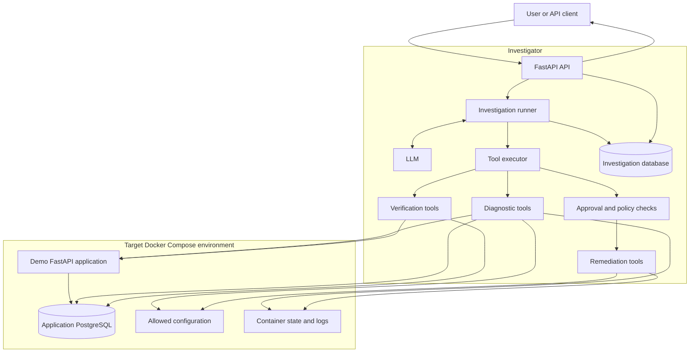
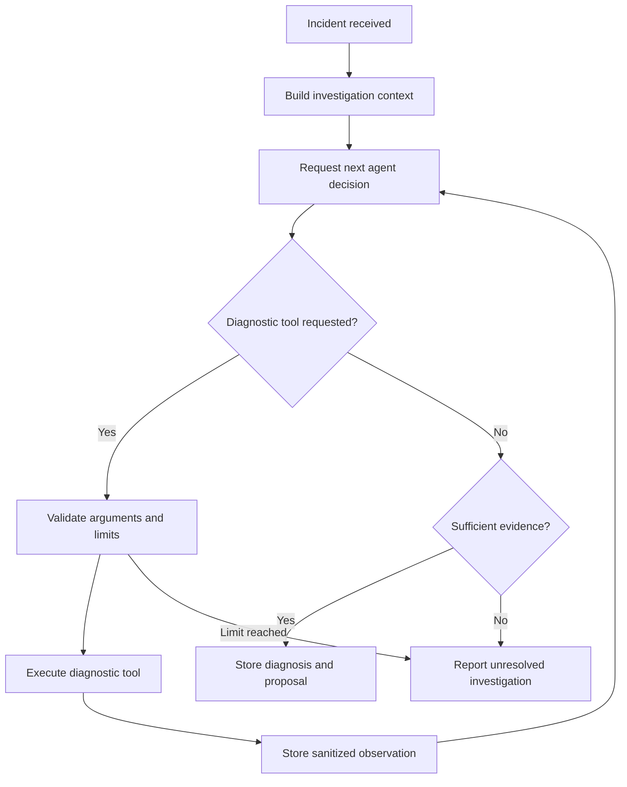
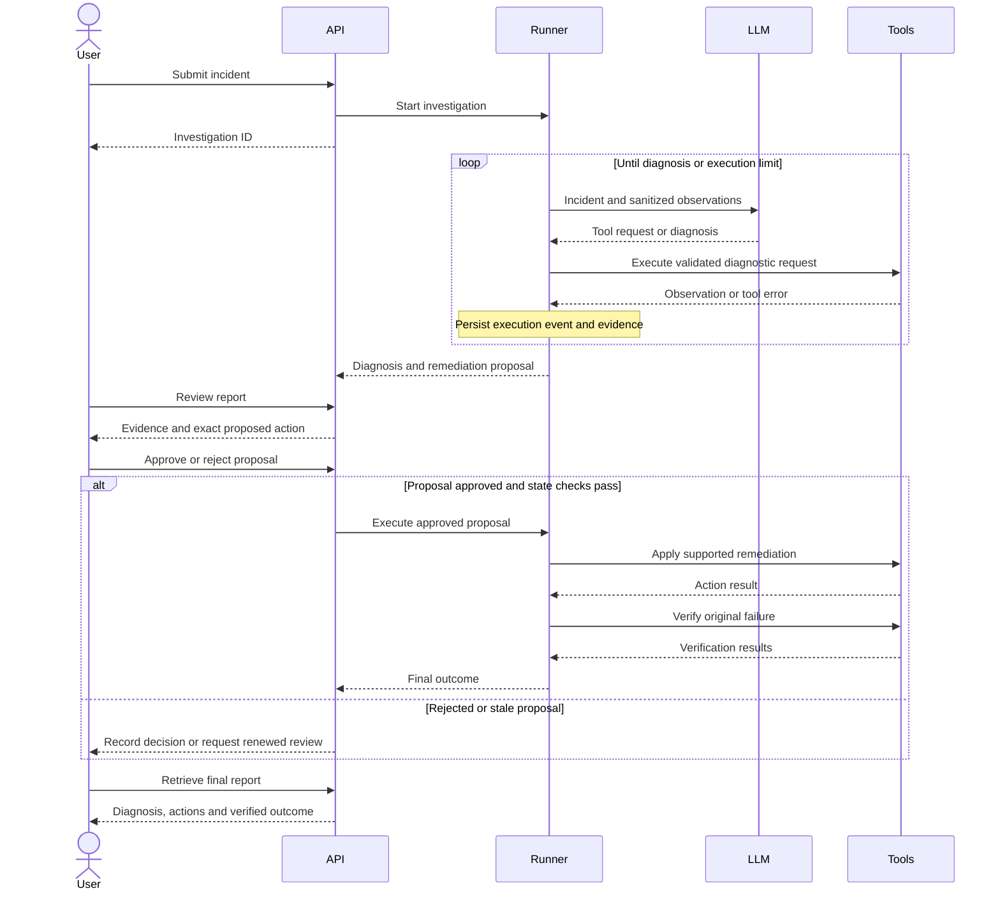
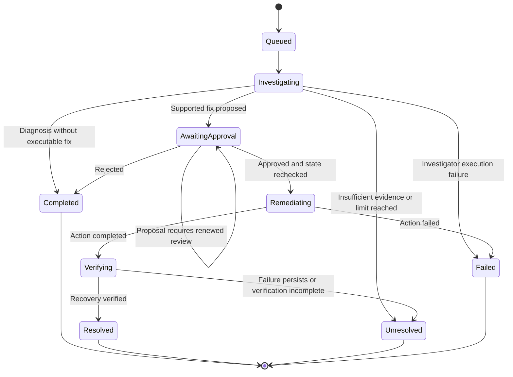

# Backend Incident Investigator

An AI agent that investigates backend failures by inspecting service health, application logs, configuration and connectivity.

It selects diagnostic tools based on collected evidence, explains the likely cause and proposes a fix. Supported changes require user approval, followed by checks to verify recovery.

> **Status:** In development. This README describes the planned architecture and initial implementation scope.

## Problem

An API returning errors does not immediately reveal what went wrong. The database might be unavailable, the application configuration might be incorrect or the service might have failed to start.

Investigating these failures requires gathering evidence from multiple sources and deciding what to check next.

Backend Incident Investigator aims to make this process traceable, with clear evidence behind each diagnosis and verification after an approved fix.

## Example Investigation

**User request:** “The orders API is returning errors. Investigate what happened.”

1. Check the application's health.
2. Read recent application logs and find a database connection error.
3. Check PostgreSQL and confirm that it is running.
4. Inspect the application's database hostname.
5. Compare it with the Docker Compose service configuration.
6. Identify the mismatch and propose a correction.
7. Wait for user approval before applying the change.
8. Recreate the affected application container.
9. Check application readiness and execute a database-backed request.
10. Report whether recovery was verified.

This is a planned demonstration scenario, not a measured result.

## Planned Features

- Adaptive selection of diagnostic tools based on previous results.
- Application and database health checks.
- Inspection of recent, bounded application logs.
- Inspection of selected configuration fields with credential masking.
- Connectivity checks from the affected application's environment.
- Diagnoses linked to collected evidence.
- Explicit approval before supported remediation actions.
- Recovery verification against the original failure.
- Persistent investigation history and execution events.
- Tool-call limits, timeouts and clear stopping conditions.

## Technology Stack

| Technology | Purpose |
|---|---|
| Python | Agent logic, diagnostic tools and remediation tools |
| FastAPI | Investigation, approval and history APIs |
| LLM tool calling | Selecting diagnostic tools and interpreting results |
| Docker Compose | Local application environment and reproducible failures |
| PostgreSQL | Investigation history and demo application data |
| HTTP and PostgreSQL clients | Health, connectivity and functional checks |

The LLM provider and model will be configurable.

## Architecture

The system has two main parts:

- **Investigator:** Runs the API, agent loop, tools and investigation storage.
- **Target environment:** Contains the application and database being investigated.

The investigation database is separate from the target application's database so that a target database failure does not prevent the investigator from recording its work.

### System Overview

### Component Responsibilities

| Component | Responsibility |
|---|---|
| API layer | Validate requests, expose investigation status and accept approval decisions |
| Investigation runner | Manage investigation state, call the LLM and enforce execution limits |
| LLM | Select tools, interpret observations and propose an evidence-backed diagnosis |
| Tool executor | Validate tool arguments, enforce allowed targets and execute registered tools |
| Diagnostic tools | Collect health, logs, configuration and connectivity evidence |
| Approval and policy checks | Ensure a remediation action is supported and explicitly approved |
| Remediation tools | Execute narrowly defined changes against the configured target |
| Verification tools | Repeat relevant checks and test the originally failing operation |
| Investigation database | Store incidents, observations, diagnoses, proposals, approvals and outcomes |
| Target environment | Provide a controlled application stack for investigation and evaluation |

### Agent Decision Loop

The LLM receives the incident description, available tool definitions and sanitized observations.

It can request another diagnostic tool or return a structured diagnosis. The application validates every tool request before execution.

The loop stops when:

- The agent produces a supported diagnosis.
- The configured tool-call or time limit is reached.
- Repeated checks produce no useful new evidence.
- More information is required from the user.
- A required tool or target is unavailable.

A tool limit or missing evidence must result in an explicit unresolved outcome.

## Data Flow

### 1. Incident Submission

The user submits:

- A description of the failure.
- A configured target environment identifier.
- Optional context, such as the failing endpoint.

The API validates the request, creates an investigation record and returns its identifier.

Targets are configured by the application. User input does not grant access to arbitrary hosts or containers.

### 2. Evidence Collection

The runner builds the LLM context using the incident description and available diagnostic tools.

For each requested tool:

1. Validate the tool name and arguments.
2. Confirm that the target is allowed.
3. Execute the tool with a timeout.
4. Limit output size and redact sensitive values.
5. Store the observation with an evidence identifier.
6. Add the sanitized observation to the next LLM request.

A tool failure is recorded as a failed check, not interpreted as proof that the target service is unhealthy.

### 3. Diagnosis

The agent returns a structured diagnosis containing:

- The suspected cause.
- References to supporting evidence.
- Remaining uncertainty.
- A proposed supported remediation, when available.

The runner validates the response structure and evidence references. Diagnosis correctness is assessed through evaluation and recovery checks.

### 4. Approval and Remediation

A remediation proposal contains the exact target, action and proposed configuration changes.

Approval is recorded against that specific proposal. Before execution, the system rechecks relevant state. A changed proposal or stale target state requires a new review.

### 5. Recovery Verification

After the approved action runs, the system:

1. Checks whether the affected service is running.
2. Checks application readiness.
3. Repeats the operation associated with the original incident.
4. Records whether the failure is resolved, persists or cannot be verified.

A successful restart alone does not count as verified recovery.

### 6. Result Retrieval

The user retrieves the investigation report and execution history through the API.

## Diagnostic Tools

The initial tools will expose narrow, structured operations.

| Tool | Purpose |
|---|---|
| `check_http_health` | Inspect an allowlisted application health endpoint |
| `get_container_status` | Retrieve container state and available health information |
| `read_service_logs` | Retrieve a bounded number of recent log lines |
| `inspect_service_config` | Read selected configuration fields with secrets masked |
| `check_service_connectivity` | Test dependency connectivity from the application's environment |
| `check_database_readiness` | Check whether the target PostgreSQL service accepts connections |

Tool results will include the target, execution timestamp, outcome and relevant observations.

## Supported Remediation

The first version will support a small set of actions.

| Action | Intended use |
|---|---|
| Start a configured service | Recover a stopped target database |
| Update an allowed configuration field and recreate the application container | Correct a database hostname mismatch |
| Update an allowed host-port mapping and recreate the application container | Resolve a confirmed host-port conflict |

A configuration change must be applied through container recreation when required. Restarting an existing container does not apply changed environment variables or port mappings.

For each action, the proposal will show:

- The affected service.
- The exact action and proposed changes.
- Supporting evidence.
- Expected effect.
- Verification steps.

If no supported action matches the diagnosis, the system will report the finding and suggested manual next steps.

## Investigation State

`Resolved` means recovery checks passed. `Completed` means the investigation ended without claiming verified recovery.

## Persistent Data

| Record | Stored information |
|---|---|
| Investigation | Incident description, target, status and timestamps |
| Tool execution | Tool name, sanitized arguments, duration, result and errors |
| Evidence | Sanitized observations and their identifiers |
| Diagnosis | Suspected cause, supporting evidence and uncertainty |
| Remediation proposal | Exact action, target, changes and proposal version |
| Approval | Decision, proposal reference and timestamp |
| Remediation execution | Executed action and outcome |
| Verification | Checks performed and final recovery result |

Database writes occur throughout the investigation so that the report reflects actual execution.

## Planned API

| Method | Endpoint | Purpose |
|---|---|---|
| `POST` | `/investigations` | Create an investigation |
| `GET` | `/investigations/{id}` | Retrieve status and report |
| `GET` | `/investigations/{id}/events` | Retrieve execution history |
| `POST` | `/investigations/{id}/proposals/{proposal_id}/decision` | Approve or reject a specific proposal |

These endpoints describe the proposed interface and may change during implementation.

## Initial Failure Scenarios

| Scenario | Evidence to collect | Recovery check |
|---|---|---|
| Stopped PostgreSQL service | Container state, connection errors and readiness results | Database accepts connections and the failing application request succeeds |
| Incorrect database hostname | Application logs, configured hostname and Compose service configuration | Application connects successfully after configuration correction |
| Occupied application host port | Container startup error and port-binding evidence | Application starts and is reachable through the approved port mapping |

The initial version targets one local Docker Compose application stack.

## Execution Controls

- Diagnostic tools operate only on configured targets.
- Configuration inspection exposes only selected fields.
- Credentials are masked before storage and LLM submission.
- Log content is treated as evidence, not as instructions.
- Tool output size, execution time and investigation steps are bounded.
- Remediation requires approval of an exact proposal.
- Failed verification remains visible in the final report.
- Arbitrary shell execution is outside the initial scope.

The investigator's API and storage should run independently of the target services being tested.

## Evaluation

Each test scenario will have a reproducible setup and a known cause.

Evaluation will measure:

- Correct diagnosis across supported failure scenarios.
- Whether diagnosis claims are supported by collected evidence.
- Successful recovery after approved remediation.
- Correct reporting of unresolved or ambiguous cases.
- Investigation duration.
- Tool calls per investigation.
- LLM token usage and estimated cost.

Healthy environments and unsupported failures will also be tested to check whether the agent avoids proposing unnecessary changes.

Results will be published after implementation and testing.

## Running Locally

Setup instructions and environment-variable documentation will be added with the first runnable implementation.

## Author

**Priyanshu Raj**  
[GitHub](https://github.com/Priyanshu-1477)
